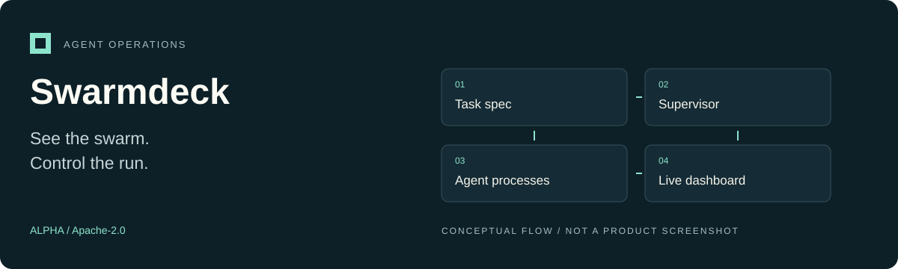

<p align="center"></p>

# Swarmdeck

**A runtime-agnostic control plane for launching, supervising, and inspecting agent processes.**

Alpha · Apache-2.0 · [Project overview](docs/OVERVIEW.md) · [Landing-page source](docs/site/index.html)

## What it does

Swarmdeck runs agent workloads as ordinary processes, supervises their lifecycle, and exposes a live dashboard. It does not require an agent framework: existing scripts work through stdout and exit codes; optional JSON-line events add progress, metrics, and delegation edges.

- **Control:** pause, resume, cancel, retry, and change concurrency.
- **Observe:** canvas-based swarm view, metrics, topology, and per-agent inspection.
- **Keep evidence:** results, logs, and a manifest under `.swarmdeck/runs/`.
- **Integrate incrementally:** process and Docker runtimes; an optional Python reporting helper.

## Quick start from source

Requirements: Python 3.10+, a POSIX environment, and Node 20.19 or newer with npm to build the dashboard. Repository access is required while this repository is private. No published package is assumed by these instructions.

```sh
git clone https://github.com/ControlStackAI/swarmdeck.git
cd swarmdeck
python -m venv .venv
. .venv/bin/activate
python -m pip install -e ".[dev]"

# Synthetic workers; no model account or API key required.
swarmdeck demo --agents 12 --concurrency 4

# Build and open the dashboard.
npm --prefix ui ci
npm --prefix ui run build
swarmdeck serve --open
```

The small demo is an introduction, not a throughput benchmark. Real agents may incur provider charges.

## Run your own workload

Create an `agent.py` that prints a result, then save this as `example.swarm.yaml`:

```yaml
name: example
concurrency: 2
command: ["python", "-u", "agent.py", "{{ task.topic }}"]
tasks:
  - topic: alpha
  - topic: beta
```

```sh
swarmdeck validate example.swarm.yaml
swarmdeck run example.swarm.yaml
```

For structured reporting, print JSON lines such as:

```python
print('{"t":"progress","pct":0.4}', flush=True)
print('{"t":"metric","tokens_in":812,"cost_usd":0.0031}', flush=True)
```

See the [event protocol](docs/PROTOCOL.md) and the [bundled examples](src/swarmdeck/examples).

## Architecture

Task specs feed a supervisor and runtime. Worker output updates shared state; the dashboard receives periodic state deltas rather than every log event. Logs are stored separately and fetched for individual agents. See [architecture](docs/ARCHITECTURE.md).

## Development

```sh
pytest -q
npm --prefix ui run typecheck
```

The source baseline passed 82 tests during the October 13, 2026 audit. This is not a scalability, UI, or production-readiness guarantee. Follow [CONTRIBUTING.md](CONTRIBUTING.md) for development conventions.

## Status and security

**Alpha.** The protocol and spec format may change. High-concurrency design choices are implemented, but no reproducible 1,000-agent capacity benchmark is published here. Additional runtime integrations are future work, not shipped features.

The server executes configured commands. It binds to loopback by default and requires a token for non-loopback binding; this is not a general-purpose execution sandbox. Read [SECURITY.md](SECURITY.md) before exposing it.

## License

[Apache-2.0](LICENSE). See also the [code of conduct](CODE_OF_CONDUCT.md).
